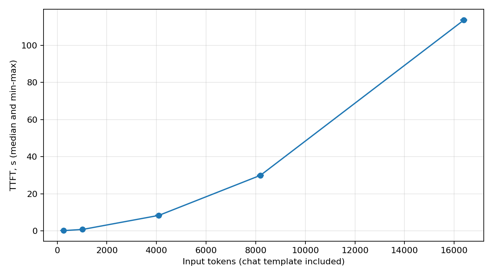
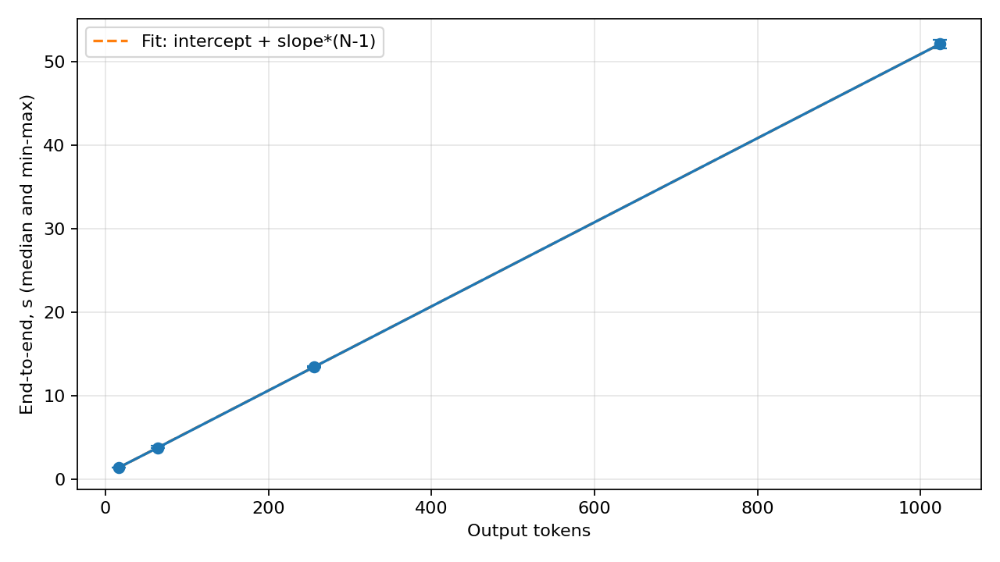
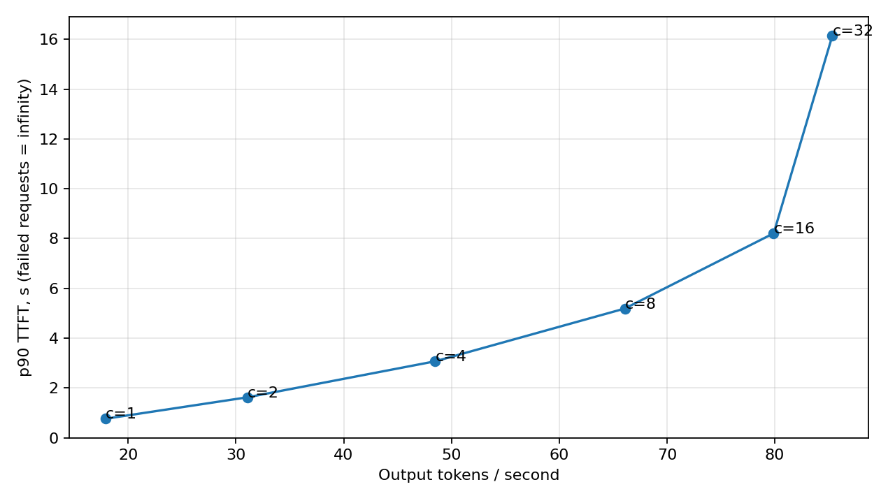

# ЛР1. Инференс и развёртывание языковой модели

Стенд, прогноз и воспроизводимость

**Вопрос.** Из чего складывается время ответа языковой модели и как оно меняется с длиной текста и числом одновременных пользователей?

**Прогноз до опытов.** TTFT растёт с длиной входа, возможно быстрее линейного; повторный префикс снижает TTFT. Полное время примерно линейно зависит от длины ответа. Ожидаемый TPOT 30-80 мс, нижняя оценка около 27 мс. Предполагалось выполнение пределов при 1-4 клиентах и нарушение при 16-32; прогноз сохранён в configs/prediction.md.

**Стенд.** Qwen/Qwen3-4B-Instruct-2507, FP16; ревизия cdbee75f17c01a7cc42f958dc650907174af0554. vLLM 0.33.0, PyTorch 2.14.0, Python 3.13.16, Tesla T4, 15360 MiB памяти; 2 логических CPU. Число потоков отдельно не задавалось (переменные OMP/MKL/OpenBLAS не установлены).

**Запуск.** Контекст 32768; gpu-memory-utilization=0.90; max-num-seqs=32; max-num-batched-tokens=2048; enforce-eager; prefix caching включён; auto tool choice с parser=hermes. Полная команда, версия драйвера и журнал сохранены в паспорте и data/server_startup.log. Исходный запуск не закреплял --revision; ревизия восстановлена из локального HF snapshot. Для повторения следует явно указать её.

**Данные и протокол.** Pride and Prejudice (Project Gutenberg №1342). Длины входов задаются токенизатором модели после шаблона диалога и проверяются по usage.prompt_tokens; длины ответов - по usage.completion_tokens. Temperature=0, остальные параметры явные, ignore_eos=True. Метка стоит первой; уникальный cache_salt изолирует обычные запросы. В опыте кеша текст и соль одинаковы.

**Память.** Веса: 8.046 GB (7.493 GiB). KV на токен: 2 × 36 × 8 × 128 × 2 = 147456 байт = 144 KiB. Кеш 32768 токенов - 4.50 GiB. Выделено 38384 токенов, то есть 5.271 GiB; журнал сообщает 5.27 GiB. Для 8 пользователей по 4000 токенов нужно 4.395 GiB: по ёмкости помещается, но скорость этим не гарантируется.

**Проверки.** Ровно 64 токена в обоих проверочных ответах; тексты при temperature=0 совпали. Пример t0=0, t1=0.4, tN=2.4, N=101 даёт TTFT=400 мс и TPOT=20 мс. Сохранены все 320 измерений без ошибок; 16 прогревов исключены. Результаты и времена фрагментов - в results.jsonl, запуски - в MLflow.

**Воспроизводимость.** Код проверял чистый Git, сохранял итоговую конфигурацию, версии, паспорт и SHA-256. Коммит измерений: fdb7114c7fbdd62546e546b283267762d6fed438. История доступна в source_history.bundle архива артефактов. Числа ниже независимо пересчитаны из первичных записей.

SHA-256 исходного текста: 3f6bb9d6f78e0293b56acd4714dd68cb7d6d1d293402031ce9d5a216bcaf9d75

## Эксперимент 1. Длина запроса и TTFT

Серия exp1_*: 5 запросов на длину, ответ 16 токенов

Запросы выполнялись по одному. Перед каждой группой один отдельный прогрев. Между измерительными запросами повторное использование префикса исключено меткой и cache_salt; сервер при этом сохранял один профиль. TTFT включает клиентскую отправку, очередь и обработку входа.

|Вход, токены|Успехи / план|TTFT, медиана, с|Диапазон, с|Входные токены/с|
|---|---|---|---|---|
|256|5 / 5|0.1387|0.1368-0.1429|1846.3|
|1024|5 / 5|0.7515|0.7451-0.7559|1362.7|
|4096|5 / 5|8.3338|8.2524-8.5199|491.5|
|8192|5 / 5|29.9503|29.8547-30.0510|273.5|
|16384|5 / 5|113.6274|113.5569-113.8373|144.2|

TTFT вырос с 0.139 до 113.627 с. При удвоениях 4096→8192 и 8192→16384 рост составил 3.59 и 3.79 раза. Рост быстрее линейного; скорость вход/TTFT снизилась с 1846 до 144 токенов/с. Это согласуется с ростом затрат внимания при длинном контексте. Влияние конкретного backend и eager-режима отдельно не изолировано.

**Prefix caching.** Для трёх одинаковых запросов по 8192 токена TTFT: 29.9090; 0.2330; 0.2292 с. Повторы ускорились в 128.3 и 130.5 раза. Экономится повторный prefill, а не генерация ответа. Агент может переиспользовать общий префикс с описаниями 24 инструментов и началом истории.

Источник: runs/lr1_final/results.jsonl; таблица reports/prefill.csv. Скорость вход/TTFT - клиентская оценка, не чистая производительность GPU prefill.

## Эксперимент 2. Длина ответа и decode

Серия exp2_*: вход 1024 токена, по 5 запросов на длину ответа

Длина ответа принудительно фиксировалась ignore_eos и проверялась по usage. TPOT=(tN-t1)/(N-1): первый токен уже учтён в TTFT. Метрики считаются по числу токенов сервера, а не числу потоковых фрагментов.

|Выход, токены|Успехи / план|Полное время, медиана, с|TPOT, медиана, мс|TTFT, медиана, с|
|---|---|---|---|---|
|16|5 / 5|1.4277|44.97|0.7531|
|64|5 / 5|3.8098|48.48|0.7610|
|256|5 / 5|13.4786|49.91|0.7521|
|1024|5 / 5|52.1185|50.20|0.7623|

Аппроксимация по четырём медианам: T(N)=0.6555+0.05030×(N-1) с. Наклон - 50.30 мс/токен, или около 19.9 токена/с. Свободный член 0.656 с близок по масштабу к наблюдаемому TTFT 0.752-0.762 с, но не равен ему: это оценка прямой по четырём точкам, а TPOT не строго постоянен.

Измеренные медианы TPOT 45.0-50.2 мс меняются намного слабее, чем длина ответа. Нижняя оценка по весам и 300 GB/с составляет 26.8 мс. Наклон примерно в 1.88 раза выше: кроме чтения весов есть KV-кеш, вычисления, планировщик и клиентский streaming. Теоретический предел предполагает идеальное использование полосы памяти.

Прогноз примерно линейного роста полного времени и TPOT в пределах 30-80 мс подтвердился. При длинном входе decode тоже может замедляться из-за большего кеша, поэтому результат нельзя переносить на произвольный контекст.

Источник: runs/lr1_final/results.jsonl; reports/decode.csv и summary.json. Интервал полного ответа заканчивается последним фрагментом текста, а не последующим пакетом usage.

## Эксперимент 3. Нагрузка и пределы сервера

Серия load_*: вход 1024, выход 128 токенов; max(16,4c) запросов

Каждый из c клиентов отправлял следующий запрос после ответа. Пределы заданы до опыта: p90 TTFT ≤2 с и медиана TPOT ≤100 мс. Goodput - число запросов, выполнивших оба индивидуальных предела, за секунду уровня. Знаменатель времени - от первой отправки до последнего текста. Все уровни непрерывные, без возобновлений.

|Клиенты|Успехи / план|p90 TTFT, с|Мед. TPOT, мс|Выход, токены/с|Goodput, запросы/с|
|---|---|---|---|---|---|
|1|16 / 16|0.762|49.8|17.91|0.140|
|2|16 / 16|1.623|55.5|31.07|0.228|
|4|16 / 16|3.069|65.0|48.50|0.166|
|8|32 / 32|5.189|92.3|66.09|0.000|
|16|64 / 64|8.210|162.1|79.90|0.000|
|32|128 / 128|16.140|332.1|85.35|0.000|

**Предел - 2 клиента среди проверенных уровней.** При c=2 p90 TTFT=1.623 с, медиана TPOT=55.5 мс. Один запрос из 16 превысил индивидуальный TTFT: поэтому goodput 0.228 ниже общего 0.243 запроса/с. При c=4 нарушается TTFT, а при c=16 - уже оба предела. Прогноз прохождения всего диапазона 1-4 подтвердился частично.

Пропускная способность выросла с 17.91 до 85.35 токена/с (4.76 раза), но задержки ухудшились и goodput при c≥8 равен нулю. Батч позволяет совместно читать веса, однако отдельный запрос обслуживается медленнее.

Наблюдавшиеся максимумы ожидающих: 0, 0, 1, 5, 13, 27; KV-кеша: 3.0%, 6.0%, 12.0%, 24.0%, 48.0%, 95.8%. Очередь появилась при c=4, когда кеш далёк от заполнения: раннюю задержку нельзя приписать нехватке KV. При c=32 кеш близок к ёмкости. Верхняя оценка памяти 38384/(1024+128)≈33 запроса; max-num-seqs=32 и задержки ограничивают полезную нагрузку раньше.

**Границы вывода.** Максимумы сняты с шагом около секунды, короткие пики могли быть пропущены. Вывод относится к этому T4, eager-режиму и профилю запросов. Для ЛР2-ЛР8 разумная исходная параллельность - 1-2; увеличение документов и описаний инструментов требует новых замеров. Результаты не обобщаются на оптимизированный vLLM и другое оборудование.

**Кодогенерация.** Код подготовлен с ИИ; проверен 12 тестами, известным примером времени, длинами usage, повтором при temperature=0, хешами и независимым пересчётом 320 записей. Таблицы и графики созданы скриптом; неуспехов нет, прогрев исключён.

Источники: задание dm780009/intsys/LR1_llm_inference_serving.pdf; Qwen/Qwen3-4B-Instruct-2507; docs.vllm.ai/en/v0.33.0; Project Gutenberg №1342. Полные ссылки - в README.

